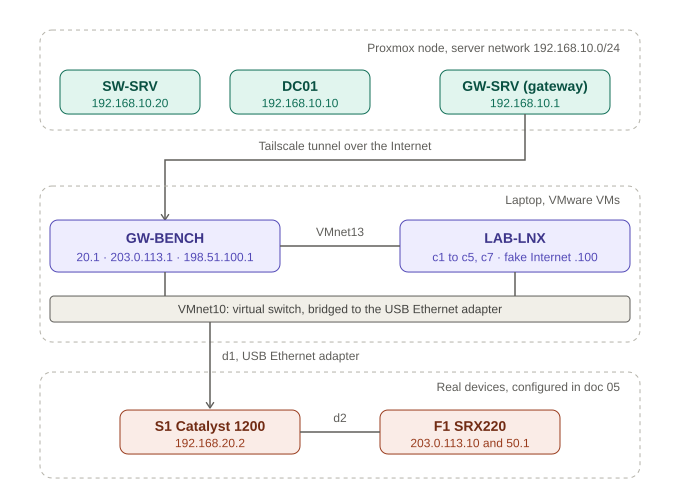
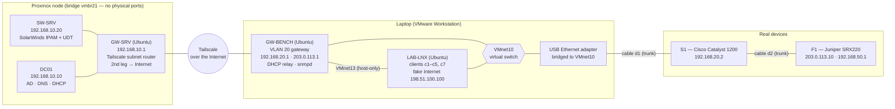
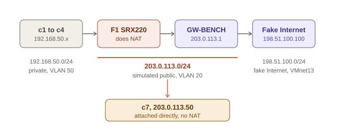

# Architecture Overview

## The system in one paragraph

A SolarWinds server (IPAM + UDT) and a small Active Directory run as three VMs on a Proxmox node. Everything the SolarWinds server is supposed to *discover* lives somewhere else: two Linux VMs on a laptop (a router and a "client farm") plus two real network devices on a bench (a Juniper SRX220 firewall and a Cisco Catalyst 1200 switch). A Tailscale tunnel joins the two halves, so the SolarWinds server polls the bench devices as if they were on the same LAN. The whole thing has no dependency on the company network beyond one VM that reaches the Internet for Tailscale.

## Diagram
## Diagram

The same system with every link and port label:

## The three places

| Place | Component | Role |
|---|---|---|
| Proxmox | **SW-SRV** | Windows Server 2022. SolarWinds Observability Self-Hosted 2026.4 with IPAM and UDT, SQL Server Express on the same box |
| Proxmox | **DC01** | Windows Server 2022. Active Directory (`lab.local`), DNS, DHCP. Serves VLAN 20 through a relay on GW-BENCH |
| Proxmox | **GW-SRV** | Ubuntu. Default gateway of the server subnet and the Proxmox-side Tailscale subnet router. Its second NIC is the only path to the Internet |
| Laptop | **GW-BENCH** | Ubuntu. Router for VLAN 20 and for the "fake Internet", DHCP relay (`dhcp-helper`), SNMP agent (`snmpd`), laptop-side Tailscale subnet router |
| Laptop | **LAB-LNX** | Ubuntu. Hosts a web server playing "the Internet" and five simulated clients (macvlan + network namespaces) |
| Bench | **F1** (SRX220) | NAT for clients c1–c4 (PAT and pool), NAT session table, SNMP |
| Bench | **S1** (Catalyst 1200) | MAC address table for UDT, VLANs 20 and 50, SNMP |

## How traffic flows

**Management and polling.** SW-SRV → GW-SRV → Tailscale → GW-BENCH → cable d1 → S1 and F1. Packets keep SW-SRV's real source address: Tailscale SNAT is switched off on both subnet routers, otherwise every SNMP request would look like it came from the gateway and tests that restrict which host may query SNMP would be meaningless.

**Clients.** Five clients live inside LAB-LNX:

- **c5, c7** sit in VLAN 20 (the "office" network, untagged).
- **c1–c4** sit in VLAN 50 (behind the firewall, tagged).

**Client to the fake Internet.** c1–c4 go: LAB-LNX (VLAN 50) → VMnet10 → USB adapter → d1 → S1 → d2 → F1 (NAT: in on VLAN 50, out on VLAN 20) → d2 → S1 → d1 → GW-BENCH → VMnet13 → `198.51.100.100`. One cable (d2) carries both VLANs: F1 is a "firewall on a stick" with tagged sub-interfaces.

**Why GW-BENCH is a VM.** There is only one real device that can route and filter (the SRX220), so it acts only as a firewall and NAT box. Routing for VLAN 20 and the DHCP relay are done by a Linux VM.

## Addressing

| Network | Range | VLAN | Members |
|---|---|---|---|
| Server subnet | `192.168.10.0/24` | none (bridge `vmbr21`) | GW-SRV .1, DC01 .10, SW-SRV .20 (static) |
| Office ("private") | `192.168.20.0/24` | 20, untagged on d1 | GW-BENCH .1, S1 .2, DHCP pool .100–.200 from DC01 via relay |
| Simulated public, same VLAN | `203.0.113.0/24` | 20 | GW-BENCH .1 (secondary address), F1 WAN .10, NAT pool .11–.14, c7 .50 |
| Behind the firewall | `192.168.50.0/24` | 50, tagged | F1 .1 (sub-interface `ge-0/0/0.50`), c1 .11, c2 .12, c3 .131, c4 .132 |
| Fake Internet | `198.51.100.0/24` | none (VMware host-only VMnet13) | GW-BENCH .1, LAB-LNX .100 |
| Tailscale | `100.64.0.0/10` | n/a | Assigned automatically; not used as a lab range |

> **Why `203.0.113.0/24` and `198.51.100.0/24`?** They are TEST-NET-3 and TEST-NET-2 ([RFC 5737](https://www.rfc-editor.org/rfc/rfc5737)): reserved for documentation, never routed on the Internet, and *outside* the three RFC 1918 private ranges. That makes IPAM classify them as public, so the Public/Private labelling and NAT scenarios can be tested without touching anyone's real address space. If the lab had used `192.168.x`, `10.x` or `172.16.x` for the "outside", IPAM would always say private.

## Design decisions worth knowing

| Decision | Why |
|---|---|
| SolarWinds on Proxmox, simulators on the laptop | The SolarWinds server needs 16 GB RAM; the laptop could not host that plus Windows and the other VMs. Proxmox node had room; the laptop could be the "remote site" |
| Bridge `vmbr21` with no physical ports | The three Proxmox VMs are invisible to the company network. Only GW-SRV has a second leg, and only to reach the Internet for Tailscale |
| Tailscale subnet routers on both sides, SNAT off | Gives a routed path between two sites with no port forwarding, and preserves real source addresses |
| `dhcp-helper` instead of ISC `dhcrelay` | `dhcrelay` could not bind to the Tailscale TUN interface; `dhcp-helper` could ([details](troubleshooting/networking.md)) |
| One cable carries VLAN 20 and 50 | Fewest cables (two, plus one spare). Risk: the USB adapter's Windows driver can strip VLAN tags, see [real devices](05-real-devices.md) |

Next: [Resources and sizing](02-resources-and-sizing.md).
