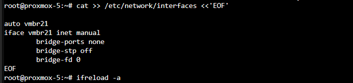
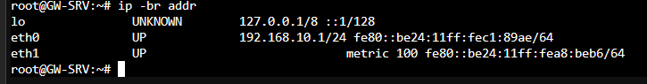
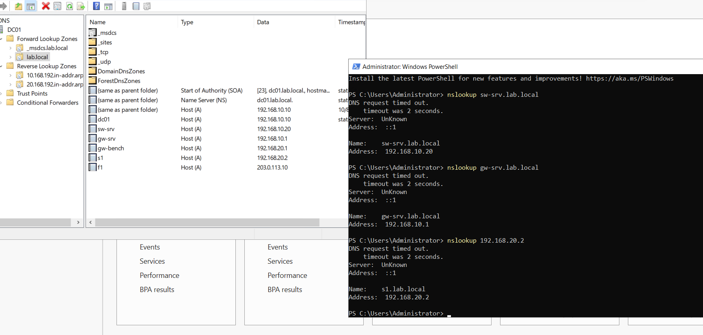
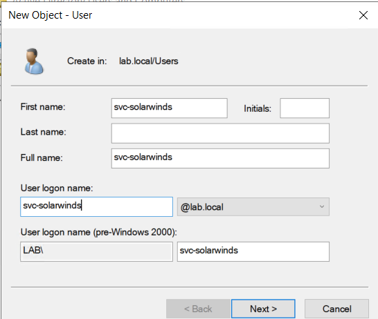

# Proxmox Side: Bridge, GW-SRV, DC01

Builds the three VMs that live on the Proxmox node. SW-SRV (VMID 450) is created later in [SolarWinds install](06-solarwinds-install.md).

| VMID | VM | Role |
|---|---|---|
| 450 | SW-SRV | SolarWinds (created last, see next doc) |
| 451 | DC01 | Active Directory, DNS, DHCP for `lab.local` |
| 452 | GW-SRV | Ubuntu gateway and Tailscale subnet router |

[SCREENSHOT 01: Proxmox web UI showing VMs 450, 451 and 452 running on proxmox-5, node addresses blacked out]

> ⚠️ **lab-only:** `ufw` on GW-SRV was left `inactive` on purpose (the exact rule set is in section 3.8). Turn it on last, from the Proxmox console, so a typo cannot lock you out.

Conventions: `[PVE]` = shell on the Proxmox node, `[GW-SRV]` = Ubuntu VM shell, `[DC01]` = PowerShell on DC01.

## 1. Pre-flight checks (read-only)

**Why:** the node hosts other people's VMs. Confirm there is room and that the VMIDs are free before changing anything.

```bash
# [PVE]
pvesh get /cluster/resources --type node --output-format json   # free RAM per node
pvesm status                                                    # storage
pvesh get /cluster/resources --type vm --output-format json | grep -o '"vmid":[0-9]*'
```

**Verify:** `available` RAM ≥ 18 GB (measured 21 GB), `local-lvm` has ≥ 150 GB free, VMIDs 450–452 are unused. Use the `available` column of `free`, not `free`, it includes reclaimable cache.

## 2. Bridge `vmbr21` (no physical ports)

**Why:** one L2 segment that exists only inside the node. The three lab VMs are unreachable from the company LAN except through GW-SRV.

```bash
# [PVE] back up, and make sure nobody has pending network changes
cp /etc/network/interfaces /etc/network/interfaces.bak-$(date +%F)
grep -n 'vmbr21' /etc/network/interfaces      # must print nothing
ls -l /etc/network/interfaces.new             # must say: No such file
```

> If `interfaces.new` exists, it is someone else's unapplied change (Proxmox writes web-UI edits there and `ifreload -a` applies everything at once). Stop; do not reload.

Append to `/etc/network/interfaces`:

```text
auto vmbr21
iface vmbr21 inet manual
        bridge-ports none
        bridge-stp off
        bridge-fd 0
```

```bash
ifreload -a
ip -br link show vmbr21     # NO-CARRIER or UNKNOWN is normal
```



**Rollback:** copy the `.bak` file back and `ifreload -a`.

## 3. GW-SRV (VMID 452)

Two NICs: `eth0` on `vmbr21` (`192.168.10.1`) and `eth1` on the uplink bridge (DHCP, Internet only, for Tailscale).

### 3.1 Clone and move the disk

The Ubuntu cloud-init template lives on a different node, on shared Ceph storage, while this node only has `local-lvm`.

```bash
# run on the node that owns the template
qm clone <template-id> 452 --name GW-SRV --full 1 --storage <ceph-pool> --target proxmox-5
```

```bash
# [PVE] while the VM is stopped
qm config 452                                   # note the disk slot names
qm disk move 452 scsi0 local-lvm --delete 1
qm set 452 --delete ide0
qm set 452 --ide0 local-lvm:cloudinit
```

| Trap | What happens |
|---|---|
| Clone straight to `local-lvm` | `can't clone to non-shared storage`, go through shared storage first |
| `Ctrl+C` during `qm disk move` | On a spinning RAID the 32 GB copy takes over an hour, and after the progress bar hits 100 % it stays silent while `qemu-img` flushes. Interrupting leaves an orphan `vm-452-disk-0` and a VM config still pointing at Ceph. Wait for the prompt |
| Template carries a Tailscale identity | If `tailscale status` shows a logged-in node, stop: two machines would share one identity |

Then set the VM hardware. `--ciupgrade 0` stops cloud-init from upgrading packages after first boot (a base-kernel upgrade once broke a DHCP client in this environment):

```bash
qm set 452 --memory 3072 --sockets 2 --cores 1 --ciupgrade 0
qm set 452 --net0 virtio,bridge=vmbr21,firewall=0 --net1 virtio,bridge=<uplink-bridge>,firewall=0
qm set 452 --ipconfig0 ip=192.168.10.1/24 --ipconfig1 ip=dhcp
qm start 452
```

> **Double-tag trap.** On this node the uplink bridge sits on a VLAN sub-interface (`nicX.108`), so the VLAN is already applied. Adding `tag=108` to `net1` makes Proxmox stack a second tag (QinQ), the DHCP server drops the DISCOVER, and `eth1` never gets an address. On trunk-style bridges (VLAN-aware, no sub-interface) the tag *is* required. Check how the bridge is built before copying someone's `qm config`.

**Verify:** `ip -br addr` shows `192.168.10.1/24` on `eth0` and a DHCP address on `eth1`; `ping -c3 1.1.1.1` works.



### 3.2 Keep the uplink subnet on the main routing table

**Why:** another node in the tailnet advertises the uplink's own subnet. Once GW-SRV runs with `--accept-routes`, Tailscale would try to carry that subnet through the tunnel, including GW-SRV's own LAN. A routing-policy rule pins traffic for that subnet to the main table ([Tailscale doc](https://tailscale.com/docs/reference/troubleshooting/network-configuration/lan-traffic-overlapping-subnets)).

Do not edit `50-cloud-init.yaml` (cloud-init regenerates it). Add a higher-numbered file:

```yaml
# /etc/netplan/61-lab.yaml   (chmod 600)
network:
  version: 2
  ethernets:
    eth1:
      routing-policy:
        - to: <UPLINK_CIDR>
          table: 254
          priority: 2500
```

```bash
sudo netplan try      # press Enter to accept
ip rule               # expect: 2500: from all to <UPLINK_CIDR> lookup main
```

### 3.3 IP forwarding and Tailscale

```bash
echo 'net.ipv4.ip_forward = 1' | sudo tee /etc/sysctl.d/99-tailscale.conf
sudo sysctl -p /etc/sysctl.d/99-tailscale.conf

curl -fsSL https://tailscale.com/install.sh | sh
sudo tailscale up --advertise-routes=192.168.10.0/24 --accept-routes \
     --accept-dns=false --snat-subnet-routes=false --hostname=lab-gw-srv
```

| Flag | Meaning |
|---|---|
| `--advertise-routes` | "send traffic for this range to me" |
| `--accept-routes` | Use routes advertised by others (off by default on Linux). Needed to reach the bench |
| `--snat-subnet-routes=false` | Keep the original source address, so SW-SRV's real IP reaches the devices |
| `--accept-dns=false` | Do not let Tailscale rewrite DNS |

Approve the advertised route in the Tailscale admin console (**Machines → Edit route settings**). **Verify:** `tailscale status` lists the laptop as online; from the laptop, `ping 192.168.10.1` answers.

### 3.4 SNMP agent

Ubuntu's `snmpd` listens on localhost with a restricted view by default.

```bash
sudo cp /etc/snmp/snmpd.conf /etc/snmp/snmpd.conf.bak
# in snmpd.conf: agentaddress udp:161 ; comment out rocommunity / rocommunity6 ; append:
rocommunity public default
sudo systemctl restart snmpd
sudo ss -ulpn | grep ':161'
```

### 3.5 Optional: temporary Internet for the lab VMs

SW-SRV needs Windows Update and the online SolarWinds installer. NAT through GW-SRV's uplink:

```bash
sudo ufw route allow in on eth0 out on eth1
sudo iptables -t nat -A POSTROUTING -o eth1 -j MASQUERADE
```

and on DC01 `Add-DnsServerForwarder -IPAddress 8.8.8.8`. Remove both when done. If outbound access from the uplink VLAN is not allowed in your environment, use the offline installer and a downloaded update package instead.

## 4. DC01 (VMID 451)

### 4.1 Create the VM

Follows Proxmox's [Windows 2022 guest best practices](https://pve.proxmox.com/wiki/Windows_2022_guest_best_practices): VirtIO SCSI single, write-back cache, discard, IO thread, VirtIO NIC, CPU type `host`, two CD drives (Windows ISO and the VirtIO driver ISO).

```bash
qm create 451 --name DC01 --memory 2048 --cores 2 --cpu host --ostype win10 \
  --agent enabled=1 --scsihw virtio-scsi-single \
  --scsi0 local-lvm:40,cache=writeback,discard=on,iothread=1 \
  --net0 virtio,bridge=vmbr21,firewall=0 \
  --ide2 local:iso/SERVER_EVAL_x64FRE_en-us.iso,media=cdrom \
  --ide0 local:iso/virtio-win.iso,media=cdrom \
  --boot 'order=ide2;scsi0'
qm start 451
```

`--ostype win10` because Proxmox 9.2 on this host had no `w2k22` type; Server 2016/2019/2022 share the NT 10.0 kernel.

### 4.2 Install Windows

In the console choose **Windows Server 2022 Standard (Desktop Experience) → Custom install**. At the disk screen, **Load driver** three times from the VirtIO ISO:

| # | Folder | Driver |
|---|---|---|
| 1 | `vioscsi\2k22\amd64` | VirtIO SCSI pass-through controller |
| 2 | `NetKVM\2k22\amd64` | VirtIO Ethernet adapter |
| 3 | `Balloon\2k22\amd64` | VirtIO Balloon driver |

| Trap | Fix |
|---|---|
| Administrator password rejected | Windows complexity: ≥ 8 characters, 3 of 4 classes (upper, lower, digit, symbol). All-lowercase-plus-digits fails |
| Login screen wants Ctrl+Alt+Del and noVNC cannot send it | From the node: `qm sendkey 451 ctrl-alt-delete` |
| No disk visible / no network after install | The matching driver was not loaded; load `vioscsi` / `NetKVM` again |

After first login install `guest-agent\qemu-ga-x86_64.msi` and `virtio-win-gt-x64.msi` from the VirtIO disc. **Verify:** `qm agent 451 ping` answers; no yellow marks in Device Manager.

### 4.3 Configure AD, DNS, DHCP

Static IP `192.168.10.10/24`, gateway `192.168.10.1`, DNS `127.0.0.1`, Remote Desktop on.

1. **Add AD DS**, promote to a new forest `lab.local`, NetBIOS `LAB`, keep DNS and Global Catalog, set a DSRM password. The "cannot create delegation for this DNS server" warning is expected, `lab.local` has no parent zone.
2. **Two reverse-lookup zones**, AD-integrated, secure dynamic updates only: `10.168.192.in-addr.arpa` and `20.168.192.in-addr.arpa`. UDT fills hostnames from these.
3. **A + PTR records** for the static machines: `dc01`, `sw-srv`, `gw-srv`, `gw-bench`, `s1`; `f1` gets an A record only (no reverse zone exists for `203.0.113.0/24`).
4. **DHCP**: install the role, authorize it in AD, then create scope `OFFICE-20`:

   | Setting | Value |
   |---|---|
   | Range | `192.168.20.100` – `192.168.20.200`, mask `255.255.255.0` |
   | Lease | 1 hour (fast re-lease tests) |
   | Router (003) | `192.168.20.1` |
   | DNS (006 / 015) | `192.168.10.10` / `lab.local` |

   > **Wizard trap:** on the Router page you must click **Add** *before* **Next**. Otherwise the option page passes without error and the scope has no 003 option (options 051, 015, 006 are present, so it looks fine). Fix without deleting the scope: Scope Options → Configure Options → tick 003 → enter `192.168.20.1` → **Add** → OK.
   >
   > DC01 sits in `192.168.10.0/24` but the scope serves `192.168.20.0/24`: DHCP picks a scope by the relay address (`giaddr`) in the packet, so the scope only answers requests relayed by GW-BENCH.

5. **Two accounts**: `svc-solarwinds` (never expires, used by SolarWinds) and `user1` (test user that UDT will see logging in).





### 4.4 Eject the ISOs

```bash
qm set 451 --delete ide0,ide2 --boot order=scsi0
qm shutdown 451 && qm start 451
```

On a running VM the change stays *pending* until a clean restart (`qm pending 451` shows it).

**Verify the build (`dcdiag /q` clean):**

| Check | Expected |
|---|---|
| `nslookup sw-srv.lab.local` / `nslookup 192.168.10.20` | `192.168.10.20` / `sw-srv.lab.local` |
| DHCP console | `[192.168.20.0] OFFICE-20` active, options 003, 006, 015, 051 present |
| Scope has 003 | `Get-DhcpServerv4OptionValue -ScopeId 192.168.20.0` lists Router |
| `qm config 451` | `boot: order=scsi0`, no `ide0`/`ide2` |

Next: [Laptop side](04-laptop-side.md).
