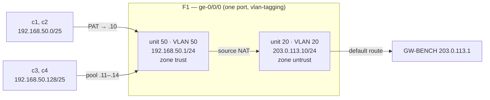
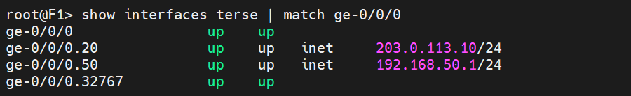
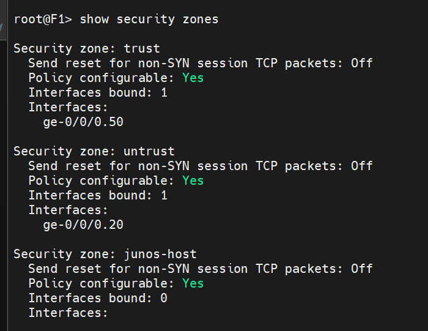
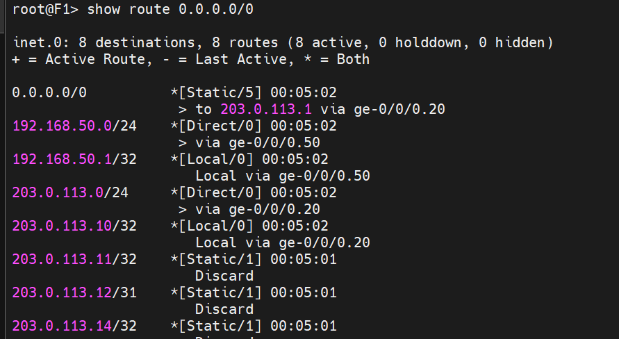
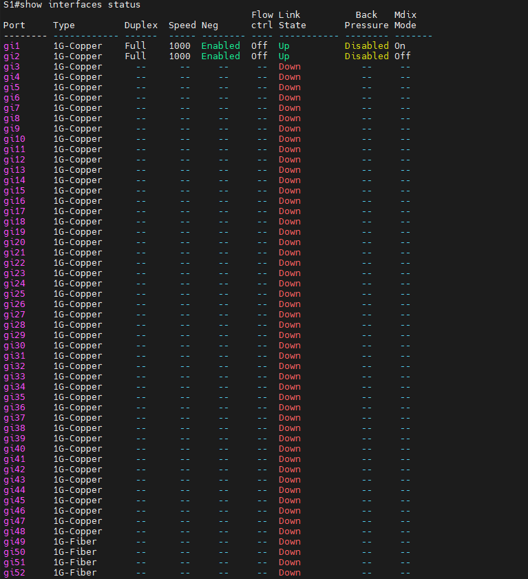
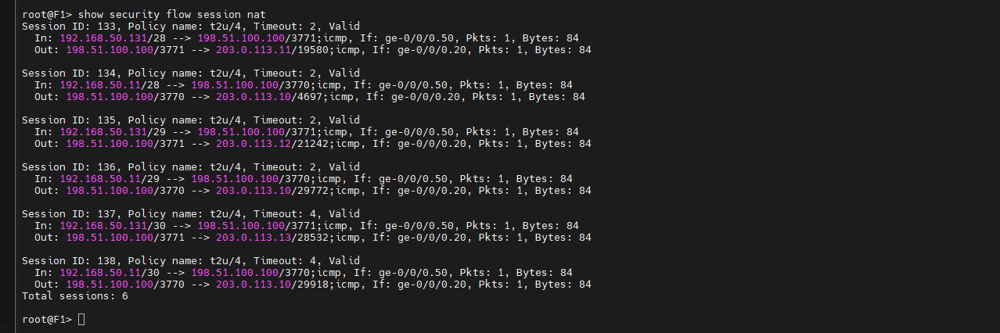

# Real Devices: SRX220 (F1) and Catalyst 1200 (S1)

Reset both borrowed devices, configure them from the console, connect two cables, and prove the path with the **G tests** (G-00 … G-12). SolarWinds is installed only after every G test passes.

| Device | Role | Hardware / software |
|---|---|---|
| **F1** | Firewall + NAT, NAT session table, SNMP | Juniper SRX220H2, Junos 12.1X44-D35.5 |
| **S1** | Switch: MAC table for UDT, VLAN 20 and 50, SNMP | Cisco Catalyst C1200-48T-4G, software 4.1.3.36 |

Order matters: **reset → configure → only then connect cables**, and never connect to the company network.

Config files: [`configs/juniper-srx220.set`](../configs/juniper-srx220.set), [`configs/cisco-c1200.txt`](../configs/cisco-c1200.txt).

## 1. Console access

One FTDI USB-serial cable is moved between the two devices. Find the port with `Get-PnpDevice -Class Ports` (a `USB Serial Port` with status `OK`).

| Device | Serial settings |
|---|---|
| SRX220 | 9600 8N1, no flow control |
| Catalyst 1200 | 115200 8N1 per the manual; in practice it auto-detected and answered at 9600 |

| Symptom | Fix |
|---|---|
| Blank terminal on the Catalyst | Change the session speed (9600 ↔ 115200), press Enter twice, or unplug and replug the console cable so the switch re-detects the speed |
| `Access denied` opening the COM port | Another program holds it. Close it |
| Port not listed by `Win32_SerialPort` | Use `Get-PnpDevice` instead; install the FTDI driver |

## 2. SRX220 (F1)

### Reset

1. Console in, press Enter.
2. Push a straightened paper clip into the **Reset Config** hole on the front and **hold it for more than 20 seconds**, until the status LED flashes red then green. A short press only loads the rescue configuration, it does not erase.
3. Power-cycle. The console shows `Amnesiac (ttyu0)`; log in as `root` (no password), then `cli`.

**Verify:** `show version` → `srx220h2`, Junos 12.1X44-D35.5; `show interfaces terse` shows `ge-0/0/0.0` as DHCP client and `ge-0/0/1`–`7` as `eth-switch`.

If the button is disabled (`set chassis config-button no-clear`), log in and run `request system zeroize`.

### Configure

Use [`juniper-srx220.set`](../configs/juniper-srx220.set). The shape of it:



Points that are easy to miss:

- `delete` first and answer `yes`; **do not `commit` until a root password is set**, or the commit is refused.
- The `host-inbound-traffic … ping` line on the *trust* zone is needed for G-12 (VLAN 50 ping test).
- The NAT pool addresses `.11–.14` exist on no interface, so `set security nat proxy-arp` is required for F1 to answer ARP for them.
- `request system configuration rescue save` after the commit, then power-cycle once to prove the configuration persists.

**Verify:** `commit check` → *configuration check succeeds*; `show security zones` places `ge-0/0/0.20` in `untrust` and `.50` in `trust`; `show route 0.0.0.0/0` → static via `203.0.113.1`.







## 3. Catalyst 1200 (S1)

### Reset

Unplug all network cables, keep power on, hold the **Reset** button 15–20 s until the console prints `SYSTEM RESET`. At `User Name:` log in with the factory credentials; the switch forces you to create a new account (≥ 8 characters, three of four character classes).

### Configure

Type [`cisco-c1200.txt`](../configs/cisco-c1200.txt) one command per line (pasting several lines at once can produce `Wrong number of parameters`).

| Port | Cable | Mode |
|---|---|---|
| `gi1` | d1 → laptop USB adapter | Trunk, VLAN 20 untagged (native), VLAN 50 tagged |
| `gi2` | d2 → F1 `ge-0/0/0` | Trunk, both VLANs tagged |
| `gi3` | none (spare) | Same as `gi1`; used for the "move the cable to another port" test |

`switchport trunk native vlan 20` is rejected until 20 is in `allowed vlan`, add it first. Ports 49–52 are SFP; do not expect a copper link there.

**Verify:** `show vlan` lists 20 and 50; `show ip interface` → `vlan 20` = `192.168.20.2/24`; `show snmp` → community `lab-ro`; after `copy running-config startup-config` the console prints `Copy succeeded`.

## 4. Connect the cables

| Cable | From | To |
|---|---|---|
| **d2** | F1 `ge-0/0/0` | S1 `gi2` |
| **d1** | USB Ethernet adapter on the laptop | S1 `gi1` |

Connect d2, check `show interfaces terse | match ge-0/0/0` on F1 and `show interfaces status` on S1, then connect d1 and ping from GW-BENCH (`192.168.20.2`, `203.0.113.10`).

[SCREENSHOT 03: the bench: SRX220, Catalyst 1200, USB Ethernet adapter and the two cables]



> **USB adapter flapping.** Once, `gi1` kept toggling `LINK-W-Down` / `LINK-I-Up` and the adapter dropped out of Windows entirely. Moving it to a different USB port fixed it and it stayed stable afterwards, keep the adapter on that port. The root cause was never proven (port, cable, adapter and driver were not isolated one by one).

## 5. G tests

Order: G-00 → G-05, then **G-12** (the NAT tests depend on it), then G-06 → G-11. All passed on 2026-10-19.

| ID | Test | Expected | Result |
|---|---|---|---|
| G-00 | Console into F1 and S1, record versions | Prompts appear | ✅ Junos 12.1X44-D35.5, SW 4.1.3.36 |
| G-01 | GW-BENCH `tailscale ping lab-gw-srv` | `pong`; relay or direct noted | ✅ direct, 111 ms |
| G-02 | DC01 ↔ GW-BENCH ping through Tailscale | Replies | ✅ 3/3 both ways |
| G-03 | DC01 pings S1 `192.168.20.2` and F1 `203.0.113.10` | Replies | ✅ 3/3 |
| G-04 | c5 gets an address in `.100–.200`, lease visible on DC01 | DHCP via relay works | ✅ `192.168.20.101`, lease Active |
| G-05 | c5 pings gateway, DC01, fake Internet | Replies | ✅ 3/3 each |
| G-12 | c1 pings `192.168.50.1` | VLAN 50 tagged frames survive the USB adapter | ✅ after fixing the driver (below) |
| G-06 | `snmpwalk` S1 `1.3.6.1.2.1.17.4.3.1` (MAC table) | MAC rows | ✅ GW-BENCH, F1, S1 itself, plus macvlan MACs |
| G-07 | `snmpwalk` GW-BENCH `ipNetToMedia` (ARP) | Neighbours listed | ✅ S1, F1, c5, c7, `198.51.100.100` |
| G-08 | `snmpwalk` F1 system group | sysName `F1` | ✅ `srx220h2`, JUNOS 12.1X44-D35.5 |
| G-09 | c1 `curl` fake Internet; F1 `show security flow session nat`; web log | Session `192.168.50.11 → 203.0.113.10` | ✅ log source `203.0.113.10` |
| G-10 | `curl` from c3 then c1 | Two different source addresses | ✅ c3 from pool `.11–.13`, c1 from `.10` |
| G-11 | `nslookup 192.168.10.20 192.168.10.10` | `sw-srv.lab.local` | ✅ |



[SCREENSHOT 04: `snmpwalk` of S1's MAC table (G-06) listing GW-BENCH, F1 and S1 itself]

### G-12 failed first: the driver strips VLAN tags

The first c1 pings got no reply. Frames left the laptop tagged, F1 answered, but the **reply came back without its VLAN tag**: the Windows driver of the USB adapter processes the `Priority & VLAN` property and discards the tag. Fix, then retest:

```powershell
Set-NetAdapterAdvancedProperty -Name "Ethernet 2" -RegistryKeyword "*PriorityVLANTag" -RegistryValue 0
```

If it still fails, check in this order: (1) S1 `gi1` allows VLAN 50, (2) F1 has the `ping` host-inbound line on `trust`, (3) the adapter property above, (4) `sudo tshark -i ens33 -Y vlan` in LAB-LNX, (5) fall back to a second USB adapter and untagged ports.

> The fallback design (two adapters, no VLAN tags, F1 `ge-0/0/1` as a separate LAN port) was documented but never needed. Its cost: S1 then sees only F1's WAN-side MAC, not the real client MACs.

**Verify persistence:** after a power cycle of both devices, `sysUpTime` (`1.3.6.1.2.1.1.3.0`) is small, both configs are intact, and G-03, G-08, G-12 pass again.

Next: [SolarWinds install](06-solarwinds-install.md).
