# IPAM Configuration

From an empty SolarWinds install to a working IPAM: nodes, subnets, groups, DHCP and DNS integration, a write-back test, per-group permissions, scan schedules.

`[Web]` = SolarWinds web console (`http://192.168.10.20:8787`), `[DC01]` = PowerShell on DC01.

> ⚠️ **lab-only:** `svc-solarwinds` was put in *Domain Admins* so the integrations would work first time. The minimum rights IPAM needs on a DHCP/DNS server were to be measured in tests I-10/I-11, which were not run (see [test results](09-test-results.md)). Do not copy this into production.

## 1. Add the nodes

**Why:** IPAM picks DHCP and DNS servers from the node list, and UDT needs the switch and firewall as nodes.

| Node | IP | Polling method |
|---|---|---|
| S1 (Catalyst) | `192.168.20.2` | SNMP v2c + ICMP, community `lab-ro` |
| F1 (SRX220) | `203.0.113.10` | SNMP v2c + ICMP, community `lab-ro` |
| GW-BENCH | `192.168.20.1` | SNMP + ICMP |
| GW-SRV | `192.168.10.1` | SNMP + ICMP |
| SW-SRV | `192.168.10.20` | WMI/WinRM + ICMP |
| DC01 | `192.168.10.10` | WMI/WinRM + ICMP, credential `LAB\svc-solarwinds` |

**Path:** `DISCOVERY → Network Discovery → Add Data → Discover My Network`: enter the six IPs, add an SNMP v2c credential `lab-ro`, choose *Manually set up monitoring after devices are discovered*, **Save & Discover Now**. In the results wizard **untick the "Unknown" rows**, then **Import**.

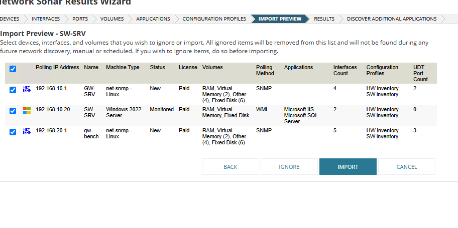

Sonar imported GW-SRV, GW-BENCH and SW-SRV but left S1, F1 and DC01 as "Unknown / status only" (the reason was never found). Add those three with **Add a Single Node**:

- *Most Devices: SNMP and ICMP*, community `lab-ro`, **Test** must say *Test Successful!*
- *Windows Servers: WMI/WinRM and ICMP* for DC01, **Test** must say *Connection method: Wmi*
- *Add UDT Ports* page: tick **Scan device for ports**, and choose the ports (see [UDT](08-udt-configuration.md))

> **UI trap:** after **OK, Add Node** the page does not navigate and shows no error. Open **Manage Nodes** in another tab and check; pressing the button twice creates duplicates.

**Verify:** `Settings → Manage Nodes` lists six nodes (Cisco, Juniper, two net-snmp, two Windows); S1 and DC01 are Up.

> F1 showed red with *"/dev/md0, mounted on /junos: Critical"*, the Junos volume reports as full, which is a normal property of the device image, not a lost connection. gw-bench and GW-SRV also showed red for reasons that were not investigated.

## 2. Import subnets and create groups

**Why:** IPAM does not know your subnets until it reads them from a router's routing table.

1. **My Dashboards → IP Addresses → Manage Subnets & IP Addresses → Discover subnets.**
2. *Specify nodes:* **untick** the pre-ticked "Default gateway" (it points at the company router). Choose *Select a monitored SNMP node* and tick **both** `gw-bench` and `GW-SRV`, `192.168.10.0/24` comes only from GW-SRV (it is in the Tailscale routing table on GW-BENCH), the others only from GW-BENCH.

   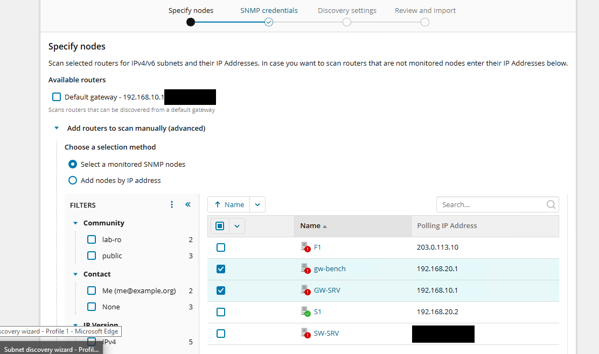

3. Keep the SNMP credentials list; discovery settings default (hop 0, timeout 3000 ms, 1 retry).
4. *Review and import:* the wizard returned 23 rows mixing the company and laptop networks. Tick **only** the four lab ranges: `192.168.10.0/24`, `192.168.20.0/24`, `198.51.100.0/24`, `203.0.113.0/24`.
5. Create groups: select **IP Networks → Add → Group**: `NOI-BO` (internal) and `PUBLIC`. Move `192.168.10.0` and `192.168.20.0` into `NOI-BO`, `203.0.113.0` into `PUBLIC`; `198.51.100.0` stays in *Imported Subnet*.

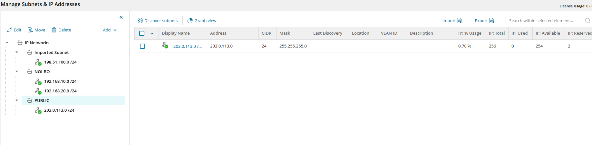

**Verify (tests I-01/I-02):** after the first scan (≤ 10 min) each subnet shows Used 3, Available 251, Reserved 2; license usage 6 / unlimited. Filtering `192.168.10.0/24` by *Used* gives `.1` (GW-SRV), `.10` (DC01), `.20` (SW-SRV); `192.168.20.0/24` gives `.1` (GW-BENCH), `.2` (S1), `.101` (c5).

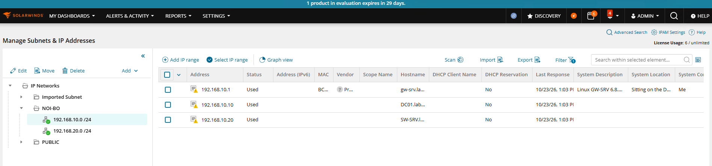

| Symptom | Cause / fix |
|---|---|
| `.20` (SW-SRV) shows **Available** though it is up | IPAM scans with ping, and Windows blocks ICMP echo by default. Enable the inbound rule *File and Printer Sharing (Echo Request – ICMPv4-In)* |
| MAC column empty for `.10` and `.20`, no name on `.101` | Not explained |

## 3. DHCP server (DC01)

**Path:** `IPAM Settings → DHCP & DNS Management → Add DHCP server` → choose node `DC01` (WMI) → *Inherit credentials from Orion node* → **Test Credentials** → defaults (scan scopes and leases every 10 min, *automatically add new scopes and subnets*) → **Add server**.

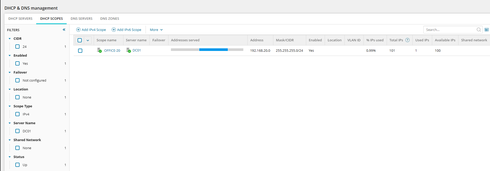

**Verify:** *DHCP SCOPES* tab shows `OFFICE-20` (server DC01, `192.168.20.0/24`, 101 total, 1 used). The `.101` row in the subnet carries c5's MAC, scope name `OFFICE-20` and the DHCP client name from the lease.

## 4. DNS server (DC01)

**Path:** `Add DNS server` → node `DC01` → *Inherit credentials* → **Test Credentials** (shows the zone count: *5 zones found*) → enable scanning every 10 min, *prefer incremental zone transfer* → **Add server**.

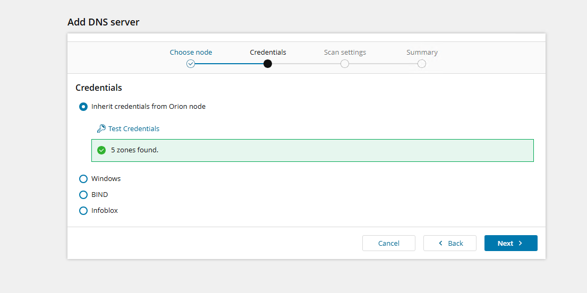

DC01 has 8 zones in reality; IPAM imported 5 (which three were skipped was not determined).

## 5. Write-back test: create a scope and a reservation from IPAM (I-06)

**Why:** a read-only IPAM only documents; the useful part is changing the DHCP server from the IPAM console.

1. `DHCP & DNS Management → DHCP SCOPES → Add` → server DC01 → name `THU-30`, range `192.168.30.10`–`192.168.30.200`, CIDR 24, keep *Add IP addresses with the subnet*.
2. Open the scope, pick an *Available* IP, press **Edit** (not **Set status**, that dialog has no MAC or client-name fields).
3. Status **Reserved**, tick **Send Reservation to DHCP Server**, keep *DHCP only*, server `DC01`, type Static, fill **DHCP Client Name** and **MAC address**, **Save**. In the pop-up use the text button **Create reservation on DHCP Server**, the blue button *in IPAM only* never touches DC01.

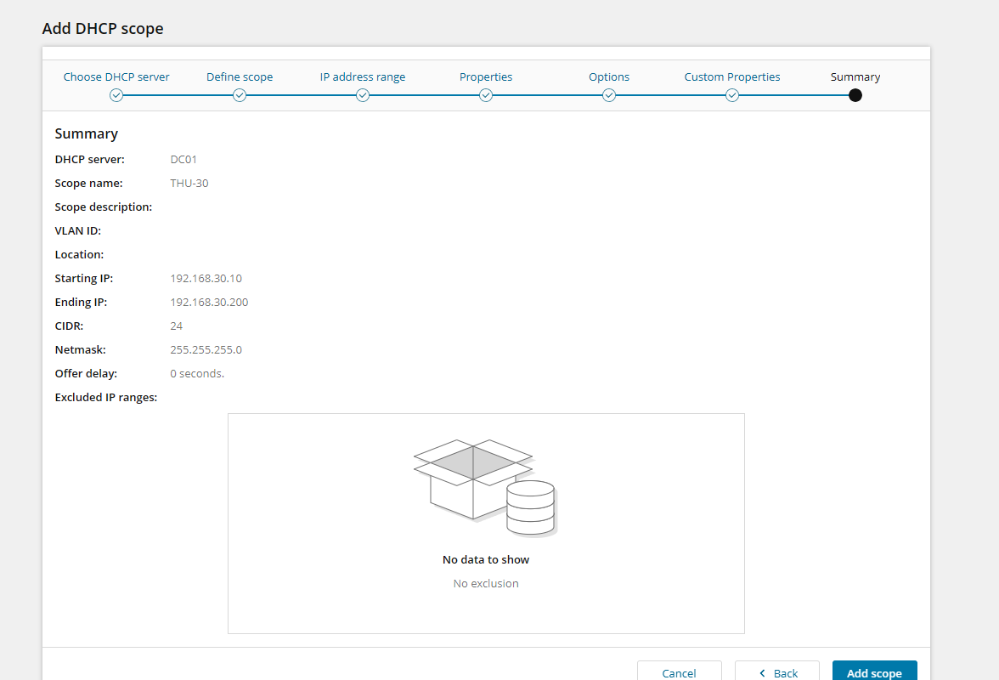

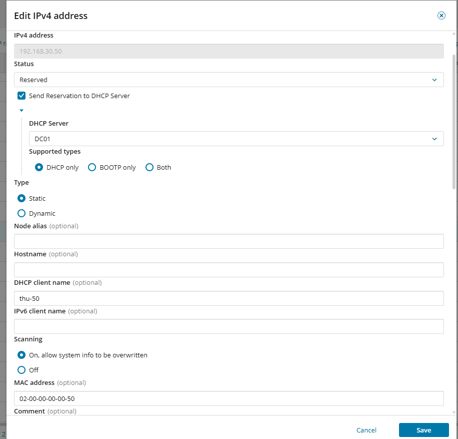

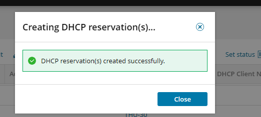

**Verify on the real server:**

```powershell
Get-DhcpServerv4Scope                         # THU-30 listed, Active
Get-DhcpServerv4Reservation -ScopeId 192.168.30.0   # 192.168.30.50, the MAC entered, type Dhcp
```

Result: the scope and the reservation exist on DC01, and IPAM itself added `192.168.30.0/24` to *Discovered Subnets*. If you save without a MAC or name you get *"Required fields are missing … No DHCP server reservation will be made"*, press **Ok**, pick the IP again, **Edit**, fill both fields.

Status icons: **Available** green tick, **Used** yellow triangle, **Transient** blue dot, **Reserved** purple dot. Clean up: `Remove-DhcpServerv4Scope -ScopeId 192.168.30.0 -Force` (this lab left `THU-30` in place).

## 6. Per-group permissions (I-08)

1. Create an ordinary account: `Settings → Manage Accounts → Add New Account` → *SolarWinds Platform individual account*; under *IPAM Roles & Permissions* choose **Custom** (per-subnet roles), **Submit**.
2. `Manage Subnets & IP Addresses` → select group `NOI-BO` → **Edit → Account Roles** → pick the account → **Change Role → Operator: read/write** → **Save**.

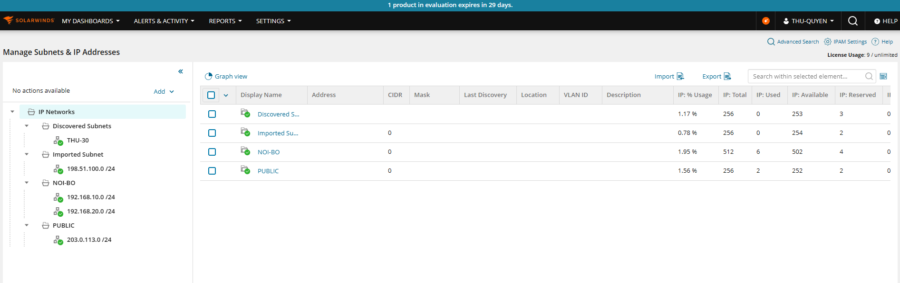

**Verified:** the account can add and edit in `NOI-BO`; in `PUBLIC` the toolbar is read-only (View details, Graph view, Scan, Import, Export, Filter) and opening *Edit group* gives `Authorization Failure`. **Not** verified, a limit worth knowing: with role *Custom* **all groups stay visible**, write is enforced, visibility is not. Hiding a group needs the role **Hide** on that group; this was not tested.

## 7. Scan schedules and neighbour scanning

**Why:** subnet scans are ping-based; **neighbour scanning** instead reads a router's ARP table via SNMP (`ipNetToMedia`, OID `1.3.6.1.2.1.4.22`), which finds hosts that do not answer ping.

1. Select the group, **tick both subnets → Edit** (bulk dialog; each section applies only if its left checkbox is ticked).
2. **Automatic scanning:** *Perform scan every* `10` minutes (the minimum; the bulk dialog's default `4` Minutes is rejected, and unedited subnets sit at `4` Hours). Tick *Update without erasing manually entered data*.
3. **Neighbour scanning** takes **one router IP per subnet**, so do it per subnet: select the *group folder* in the left tree, tick **one** subnet row, **Edit** (clicking the subnet in the tree opens "Edit IPv4 address" instead). `192.168.10.0/24` → `192.168.10.1`; `192.168.20.0/24` and `203.0.113.0/24` → `192.168.20.1`. Set 10 minutes, press **Test** (*Test successful!*), **Save**.

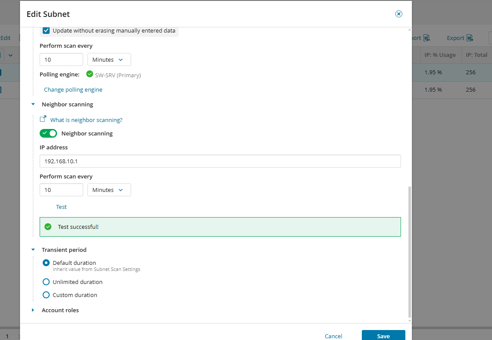

### Finding: neighbour scanning produces false "Used" addresses for a NAT pool

After enabling it on `203.0.113.0/24`, the list showed `.11`–`.14` as **Used**, vendor Juniper, with F1's MAC, but no host owns those addresses. They are the SRX220's source-NAT pool, and F1 answers ARP for them (`proxy-arp`), so the router's ARP table has entries and IPAM trusts the table.

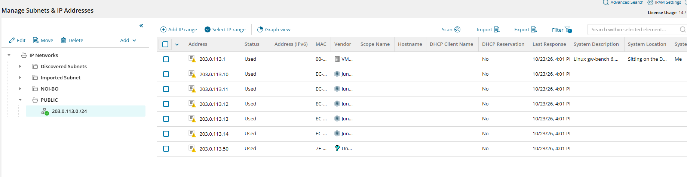

Consequence for real deployments: any address answered by proxy-ARP (NAT pools, VIPs, HSRP/VRRP, load balancers) looks like a live device when neighbour scanning is on. Cross-check the vendor/MAC column before treating "Used" as "occupied by a host".

## 8. SW-SRV self-monitoring noise

| Item | Action |
|---|---|
| AppInsight for SQL "Unknown state" alert | `Manage Nodes → SW-SRV → List Resources` → untick `Microsoft SQL Server – SOLARWINDS_ORION` → Submit |
| Polling IP bound to the temporary Internet NIC | `Edit Properties → Polling IP Address = 192.168.10.20`, **before** removing that NIC |
| Memory usage above the Critical (90 %) threshold | Measured 92 % of 16 GB: `SolarWinds.BusinessLayerHost` ≈ 4.6 GB in total, `sqlservr` 2.4 GB, `w3wp` 1.6 GB, a browser 1.3 GB. Closing the browser on the server frees about 1.3 GB. Raising the VM's RAM needs a restart and about 4 GB of host headroom, not done |

Next: [UDT configuration](08-udt-configuration.md).
