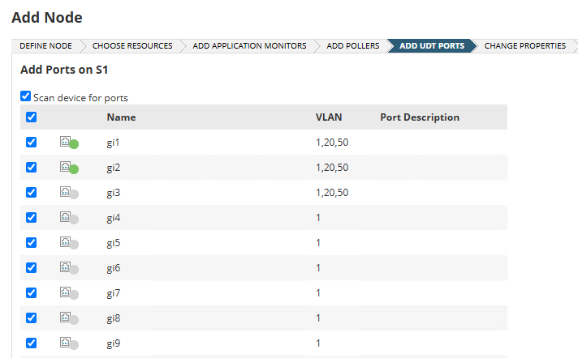
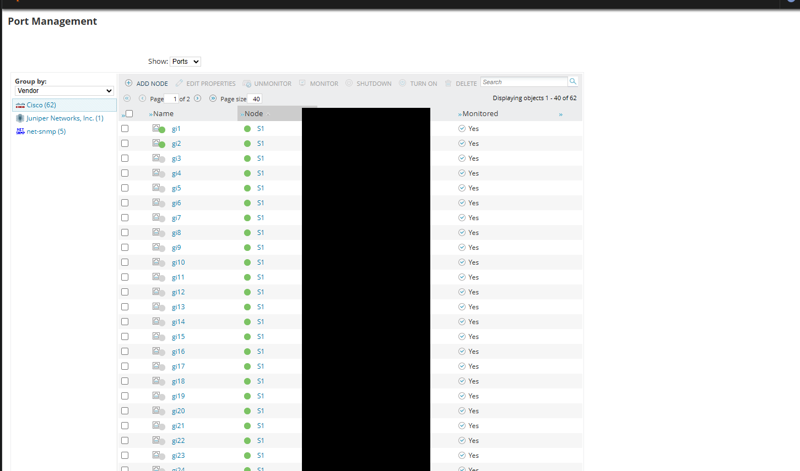
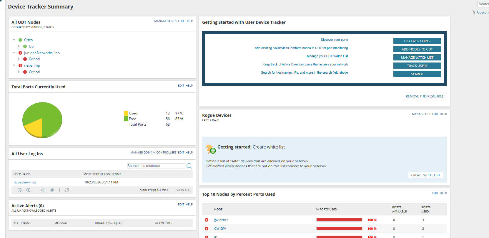
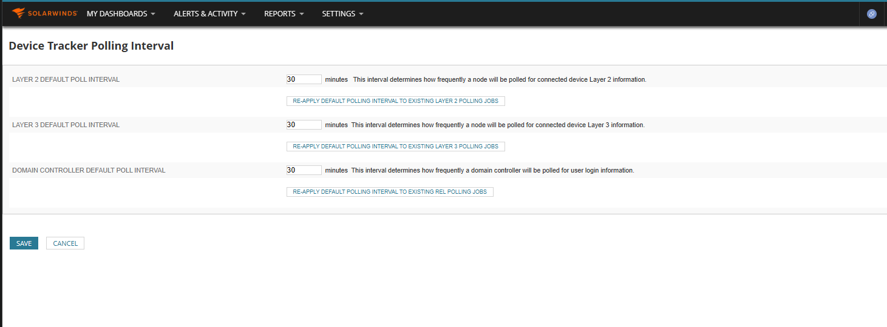
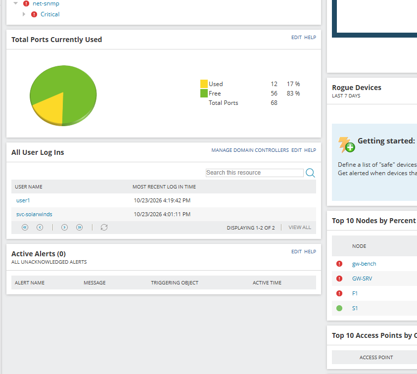
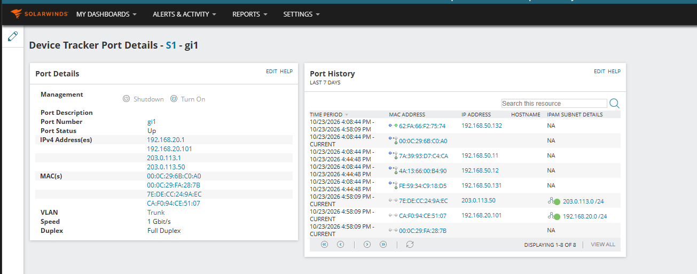
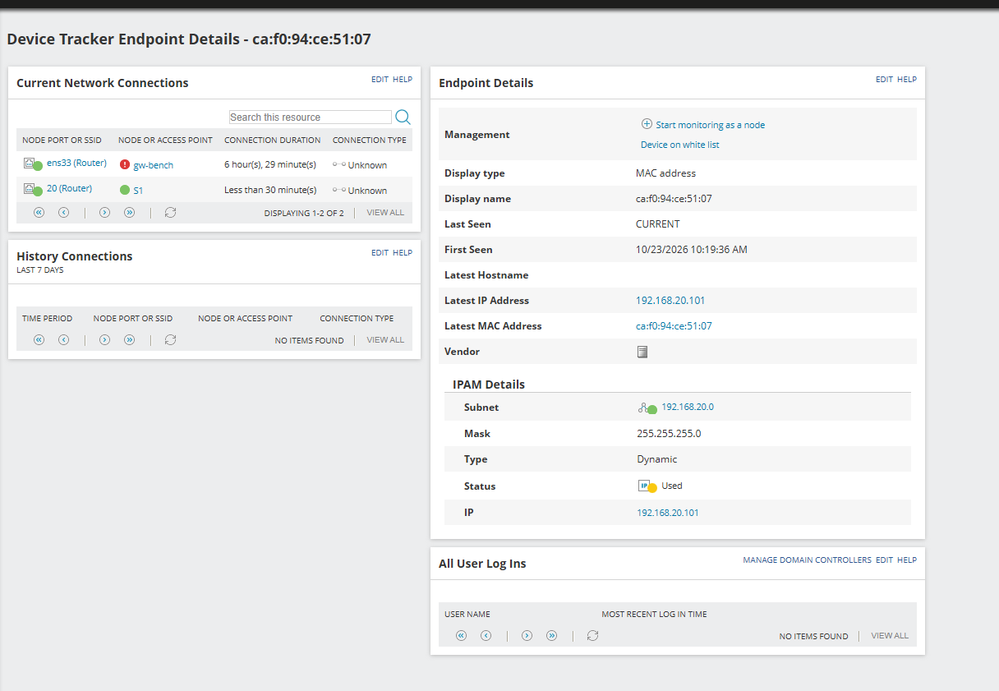

# UDT (User Device Tracker) Configuration

UDT answers "which device, which user, which switch port". It gets that from three sources: the switch's MAC address table (SNMP), routers' ARP tables (SNMP), and the domain controller's logon events (WMI). This page connects UDT to S1, DC01 and the routers, and records the behaviours that are not obvious from the manual.

Prerequisites: S1 and F1 are nodes ([IPAM configuration, section 1](07-ipam-configuration.md)); DC01 is a node with WMI credentials.

## 1. Credential for Active Directory logons

**Why:** logons are read from the domain controller's Security event log. The account must be in **Event Log Readers** on the DC and have WMI access to the CIMV2, directory and RSOP namespaces ([SolarWinds doc](https://documentation.solarwinds.com/en/success_center/udt/content/udt-manage-active-directory-credentials-in-udt.htm)).

```powershell
# [DC01]
Add-ADGroupMember -Identity "Event Log Readers" -Members svc-solarwinds
```

**[Web] Settings → All Settings → UDT Settings → Add, Edit or Delete UDT Credentials → Add UDT Credential:** name `Event Log Reader`, user `LAB\svc-solarwinds`, password, gMSA empty.

Then `Settings → Manage Nodes` → tick **DC01** → **Edit Properties** → *Active Directory Domain Controller* → tick **Poll to monitor Active Directory users logged in to your network**, choose the credential, **Test**, **Submit**.

## 2. Ports on the switch

**Why:** UDT only tracks endpoints on ports it *monitors*. The *Add UDT Ports* step of the node wizard lists every port; choose the ones that matter.



Observed behaviour:

- After adding S1, **Manage Ports** showed no Cisco ports at all (only the Juniper port and five net-snmp ports). Fix: `Show: Nodes → Filter: UDT Unmonitored Nodes` → tick S1 → **Monitor Node with UDT**, then `UDT Monitored Nodes → Poll now`.
- After the next poll UDT had imported **all 62 ports** (`gi1`–`gi52`, `Po1`–`Po4`, others), not just `gi1` and `gi2`. Each monitored port counts against the license; to trim: *Page size 100 → tick the header checkbox → **Unmonitor***, then tick `gi1` and `gi2` → **Monitor**.
- Shutting a port down from the console (**Shutdown / Turn on**) requires read/write SNMP credentials on the node (test U-08, not run).



*(The MAC column is blacked out.)*

## 3. What UDT sees, and when

Open **My Dashboards → Device Tracker → Device Tracker Summary**.



| Widget | Observed |
|---|---|
| Total Ports Currently Used | 68 ports (S1 62, F1 1, net-snmp 5): 12 used, 56 free |
| All UDT Nodes | Cisco node Up; Juniper and net-snmp nodes Critical (node status, not investigated) |
| All User Log Ins | `svc-solarwinds` (first reading proved UDT can read DC01's log) |

**Default polling intervals** (`Settings → UDT Settings → Device Tracker Polling Interval`): Layer 2, Layer 3 and domain-controller polling are **30 minutes each**. After changing a value, press *Re-apply default polling interval to existing … polling jobs* or the existing jobs keep the old interval.



### AD user log-ins (test U-07)

After a logon on a domain machine (`net use` against DC01 as `LAB\user1`), the **All User Log Ins** widget showed `user1` with the logon time, next to `svc-solarwinds`. The reading lags the event by up to one polling interval.



## 4. Finding an endpoint

Search box on the summary page → choose the match type (hostname, IP or MAC; each extra type slows the search; `*` wildcards allowed) → Enter. A single hit opens the endpoint page with switch and port.

[SCREENSHOT 07: the UDT Device Inventory list with MAC, IP and switch-port columns]

### Finding: the MAC is only on the switch if its frames traverse the switch

Test U-03 searched for client c5's MAC and expected "switch S1, port gi1". The first result listed only `ens33 (Router)` on `gw-bench`.

Investigation: reading S1's FDB over SNMP (`dot1qTpFdbPort`) five minutes after c5 stopped sending showed no entry for c5 or c7. c5 and c7 talk only to GW-BENCH, **and both sit inside the same VMware virtual switch (VMnet10) on the laptop**, so their frames never leave the laptop and never touch S1. A switch learns a MAC only from frames that arrive on a port; unused entries age out after about 5 minutes.

Fix: make the traffic cross the physical switch, c5 pings S1 (`192.168.20.2`), c7 pings F1 (`203.0.113.10`). Immediately afterwards S1's FDB held c5 and c7 on the bridge port of `gi1`. c1–c4 (VLAN 50, via F1) were always present because their traffic does physically traverse S1.

Practical meaning: **UDT shows where traffic flows, not where devices exist.** An endpoint that is silent for longer than the FDB age-out, or whose peers share its virtual/hardware switch, can disappear from UDT even though it is connected.

After the pings and a new poll, the `gi1` port page listed c5 (`192.168.20.101`), c7 (`203.0.113.50`) and LAB-LNX, each with IPAM subnet details:



### Open question: why the endpoint page says "20 (Router)"

The c5 endpoint page lists two current connections: `ens33 (Router)` on `gw-bench` and **`20 (Router)`** on S1, the VLAN-20 *interface*, not the physical port `gi1` that the port page shows. Why the two pages disagree was not resolved. A plausible reading (not verified): UDT also records MACs seen in the **ARP table of a router** and treats any interface where the MAC appears as a "connection". Old community threads say UDT lists endpoints on *every* device that has the MAC in a table, including router ports, and recommend leaving router and uplink ports unmonitored if you only want access ports.



## 5. IPAM ↔ UDT integration

IPAM detects UDT automatically and adds user and switch-port columns to the IP address table (needs UDT ≥ 3.2 and IPAM ≥ 4.3). The endpoint page above already shows the reverse direction: an *IPAM Details* block with subnet, mask, type (Dynamic), status (Used) and IP. The IPAM columns themselves (test U-10) were not captured.

## 6. Not configured

White list, Watch List and the "rogue device" alert were not set up (widget *Rogue Devices* shows the "create a white list" prompt). The menu path was not recorded.

Next: [Test results and findings](09-test-results.md).
