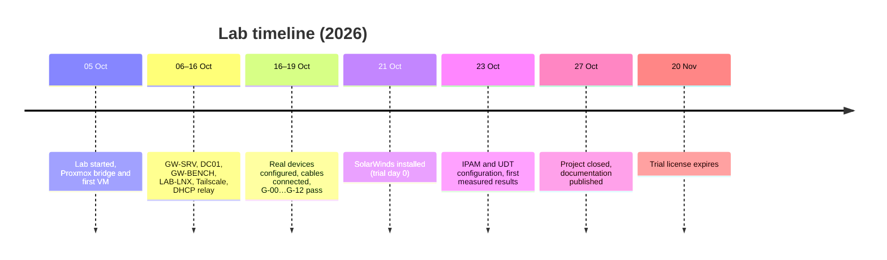

# Project Status and Hand-over

## Where the project stopped

The internship ended on **2026-10-27**, before the 30-day trial schedule could be completed. The infrastructure is built and verified; the core IPAM and UDT behaviours were measured; the large extended test catalogue was never started. This repository documents the state at that point.

| Area | State |
|---|---|
| Proxmox side (bridge, GW-SRV, DC01) | Done. `ufw` on GW-SRV intentionally left off |
| Laptop side (GW-BENCH, LAB-LNX, relay, tunnel) | Done |
| Real devices (SRX220, Catalyst 1200) and G tests | Done, 13 / 13 passed, configs survive power cycle |
| SolarWinds install and trial | Done; expires 2026-11-20 |
| IPAM configuration | Done: nodes, subnets, groups, DHCP + DNS integration, write-back, roles, scan schedule |
| UDT configuration | Done: AD credential, S1 ports, MAC tracking, user log-ins, polling intervals |
| Core tests I, U | 7 passed, 5 partial, 12 not run, see [results](09-test-results.md) |
| Extended catalogue (96 scenarios) | Not run |
| Final snapshot set (`BASE-SW`) | Not taken |

## Open items

None of these block reading the documentation; they are what a successor would pick up.

| Item | Detail |
|---|---|
| SW-SRV memory | 92 % used; raising to 20 GB needs a restart and about 4 GB of host headroom, undecided |
| Test scope `THU-30` | Created on DC01 for the write-back test (I-06) and left in place |
| 62 monitored switch ports | Only `gi1` and `gi2` matter; the rest count toward the license |
| `lab-clients.service` | Written, never installed; clients must be rebuilt by hand after a LAB-LNX reboot |
| Screenshots 01 to 07 | Marked `[SCREENSHOT NN]` in the docs, listed in [screenshots](screenshots.md); not taken before the lab was shut down |
| Role *Hide* (I-08) | Not tested |
| Endpoint page shows `20 (Router)` | Cause unknown (see [UDT](08-udt-configuration.md)) |
| Red status of F1, GW-BENCH, GW-SRV in SolarWinds | Cause not investigated (F1: the `/junos` volume reading full) |
| White list / Watch List / rogue-device alert | Not configured |
| Snapshot step "BASE-SW" and the restore-cleanliness test (S-01) | Not done |
| Trial expiry | 2026-11-20; after that polling stops |

## If you want to rebuild this

Order that worked, with the time each part took the first time:

1. [Resources and sizing](02-resources-and-sizing.md) — decide where SolarWinds runs (needs 16 GB RAM).
2. [Proxmox side](03-proxmox-side.md) — bridge, GW-SRV, DC01.
3. [Laptop side](04-laptop-side.md) — virtual networks, GW-BENCH, LAB-LNX, relay.
4. [Real devices](05-real-devices.md) — configs, cables, G tests. **Do not install SolarWinds before all G tests pass.**
5. [SolarWinds install](06-solarwinds-install.md) — snapshot first; the clock starts here.
6. [IPAM](07-ipam-configuration.md) and [UDT](08-udt-configuration.md) configuration.
7. Run the tests, starting with the ones in [test results](09-test-results.md) marked "not run".

Hardware and accounts needed: one Proxmox node with ≥ 22 GB free RAM, a laptop with ≥ 16 GB, one SRX220 (or any router/firewall with source NAT and SNMP), one managed switch with VLANs and SNMP, a USB Ethernet adapter, one console cable, two or three RJ45 cables, a Tailscale account, a SolarWinds trial (business e-mail).

## What would be done next

1. Finish the core tests that need no new equipment: I-07 (overlapping subnets), I-09 (duplicate IP alert), I-10/I-11 (minimum DHCP rights and the ports IPAM really uses, a capture with Wireshark), I-12 (license counting), U-04 to U-06 (DHCP change, port change, PTR removal), U-08 (port shutdown), U-10 (UDT columns in IPAM).
2. Finish the five-machine NAT experiment and build the correlation table (host → private IP → public IP) from F1's NAT session table plus UDT.
3. Reduce SW-SRV memory pressure, then take the clean `BASE-SW` snapshot set so scenarios can start from the same point each time.
4. Run the LB group (labelling public/private) and the EX group (exposure review with scheduled `nmap` and `ndiff`).

## Lessons

- **Build the whole system, then install the product with the clock.** Doing the devices and G tests first meant none of the 30 trial days were spent debugging cables.
- **Test with the ground truth in hand.** A web server that logs the source address, and a switch you can query directly by SNMP, turned several "SolarWinds is wrong" suspicions into "the traffic never went there" within minutes.
- **A passive discovery tool depends on traffic.** Most surprising results (UDT missing a host, IPAM showing phantom hosts) came from how switches and routers fill their tables, not from the product.
- **Write the failure down while you still remember the cause.** Most of [troubleshooting](troubleshooting/networking.md) came from this habit.
