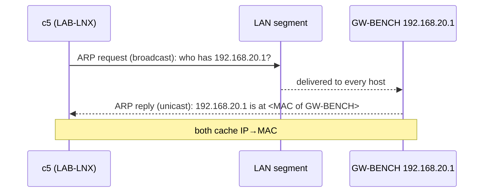
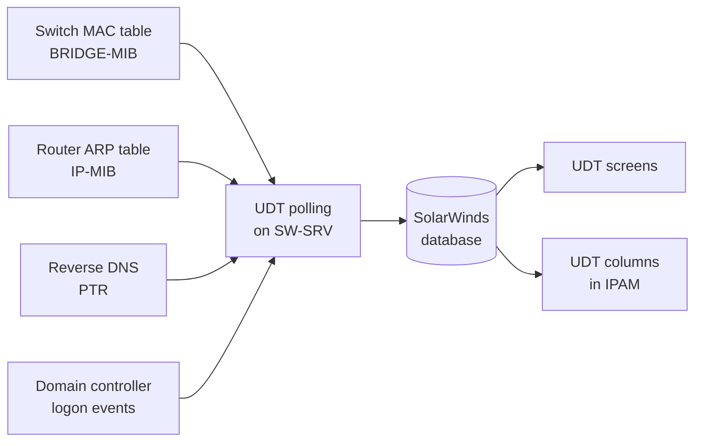
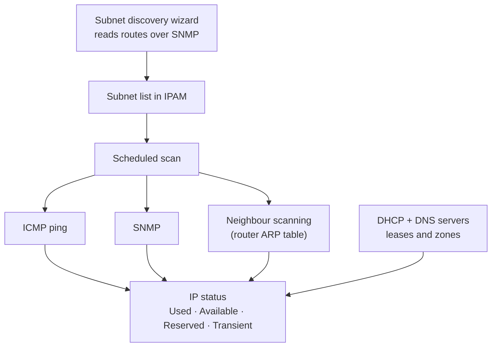

# Background: ICMP, ARP, SNMP, DHCP relay, and how IPAM and UDT use them

Short primer for the mechanisms the lab tests rely on. Each section ends with what it means for IPAM or UDT.

## ICMP (ping)

IPAM's default way of asking "is this address in use?" is an ICMP echo. **Windows hosts drop echo requests by default**, so an up server can look free. In this lab SW-SRV showed as *Available* until the inbound rule *File and Printer Sharing (Echo Request – ICMPv4-In)* was enabled.

## ARP

ARP (RFC 826) maps an IP address to a MAC on the local Ethernet segment: broadcast request ("who has this IP?"), unicast reply, both sides cache the result.

**Meaning:** a router's ARP table is the answer to "which IP does this MAC use?". UDT reads it for the IP column; IPAM's *neighbour scanning* reads the same table. Anything that answers ARP on someone else's behalf (**proxy ARP**) pollutes it, see the NAT-pool finding in [test results](09-test-results.md).

## SNMP

| Version | Security |
|---|---|
| v1, v2c | A plain-text *community string* acts as password. No encryption |
| v3 | User-based security model: authentication and optional encryption (noAuthNoPriv, authNoPriv, authPriv) |

The lab uses v2c with read-only communities (`lab-ro` on the real devices, `public` on the Linux gateways) in an isolated network. Do not expose v2c to the Internet.

OIDs that matter here:

| Table | OID | Content |
|---|---|---|
| `dot1dTpFdbTable` (BRIDGE-MIB, RFC 4188) | `1.3.6.1.2.1.17.4.3` | Learned MAC addresses and the bridge port each was seen on |
| `dot1qTpFdbPort` (Q-BRIDGE-MIB) | `1.3.6.1.2.1.17.7.1.2.2` | The same, per VLAN |
| `ipNetToMedia` / `ipNetToPhysical` (IP-MIB) | `1.3.6.1.2.1.4.22` | The ARP table |

Manual probe: `snmpwalk -v2c -c lab-ro -On 192.168.20.2 1.3.6.1.2.1.17.4.3.1.2`. UDT documents 89 OIDs it needs (IF-MIB, BRIDGE-MIB, IP-MIB, LLDP, plus vendor-specific ones).

## DHCP and DNS in this lab

- **DHCP relay.** DC01 is on `192.168.10.0/24`, the clients on `192.168.20.0/24`. A client's broadcast cannot cross the tunnel, so GW-BENCH relays it to DC01 and writes its own address on that segment into the packet (`giaddr`). DC01 picks the scope whose subnet contains `giaddr`, so the scope `OFFICE-20` only answers relayed requests from VLAN 20.
- **Reverse DNS.** UDT fills the hostname column by PTR lookup. No PTR → no name. That is why DC01 carries two reverse zones with A+PTR records for the static machines.

## How UDT gets its data

"Which port is this MAC on?" comes from the switch's MAC table; "which IP?" from a router's ARP table; "which hostname?" from PTR; "which user?" from DC logon events. Every one of these is a **table snapshot taken on a polling interval** (30 minutes by default), and the switch table is only as fresh as the traffic that keeps entries alive.

## How IPAM scans

The vendor's documentation names the three scan methods (ICMP, SNMP, neighbour) but does not say how each contributes to a status; the lab's packet-level check of that (test I-03) was only done through the neighbour path, using an address that cannot be pinged (c7).
