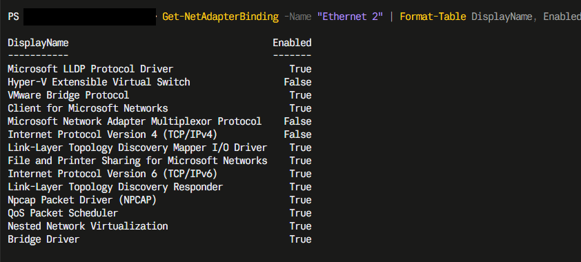
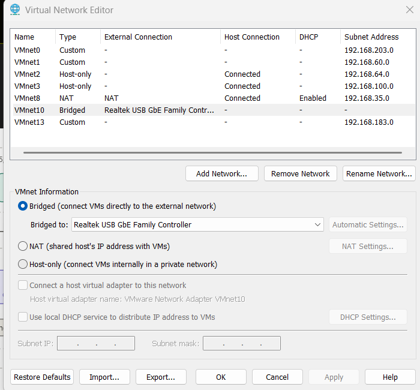
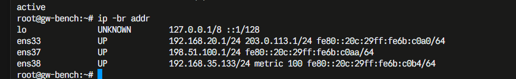
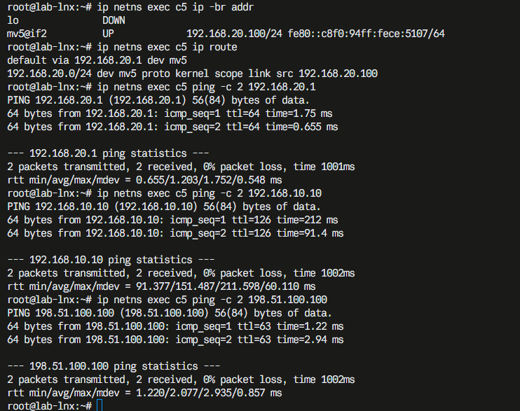
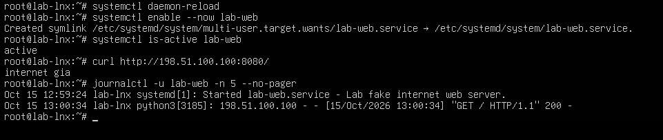
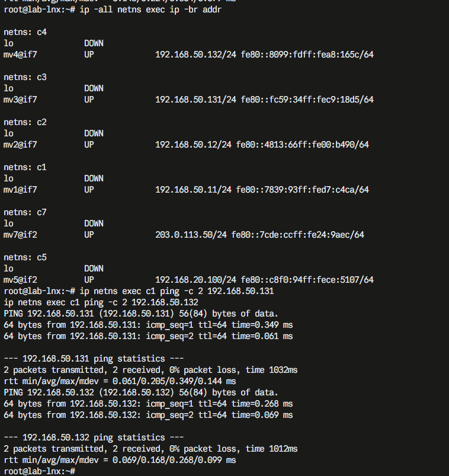
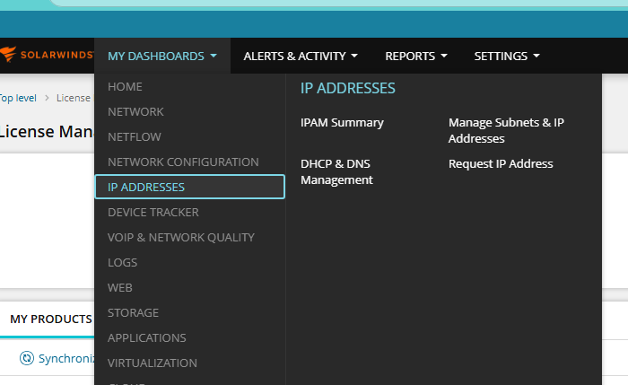
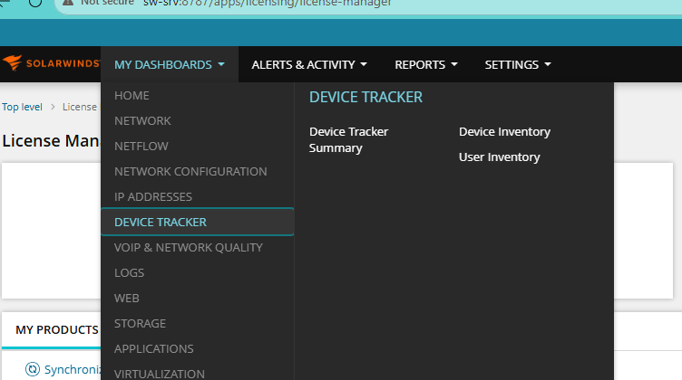

# Screenshots

Captured from the running lab between 2026-10-05 and 2026-10-23: the infrastructure terminals during the build, the SolarWinds consoles on 2026-10-23, the day most of the IPAM and UDT measurements were taken. Not staged, not from a vendor demo. Internal and company addresses, browser bookmarks and the real switch's MAC column are blacked out; everything else is what the console showed. The `192.168.x`, `203.0.113.x` and `198.51.100.x` addresses are the lab's own (the last two are RFC 5737 documentation ranges).

Each image is also embedded in the page where it is explained.

## Infrastructure

**Proxmox side**

**Laptop side**

**Real devices**

**SolarWinds menus after the trial license**

## IPAM

**Node discovery: import preview**

**Subnet discovery: choosing the routers to read**

The default-gateway line and SW-SRV's address (company network) are redacted.

**Groups and a subnet after the first scan**

**DHCP and DNS integration**

**Write-back: a reservation created from IPAM on the real DHCP server**

**Permissions: the ordinary account's view**

**Neighbour scanning**

The second image is the false-positive finding discussed in [test results](09-test-results.md).

## UDT

**Selecting ports when adding the switch**

**What UDT imported**

**Users and endpoints**

**Polling intervals**

## Not yet captured

The docs mark these spots with `[SCREENSHOT NN: ...]`. The lab was taken down and will not be restarted, so they were never taken; each is a console view that is easy to reproduce if the lab is rebuilt.

| # | Where | What it should show |
|---|---|---|
| 01 | [Proxmox side](03-proxmox-side.md) | VMs 450, 451, 452 running on `proxmox-5` in the Proxmox web UI |
| 02 | [Laptop side](04-laptop-side.md) | `tailscale status` on GW-BENCH |
| 03 | [Real devices](05-real-devices.md) | The bench: devices, USB adapter, the two cables |
| 04 | [Real devices](05-real-devices.md) | `snmpwalk` of S1's MAC table (test G-06) |
| 05 | [SolarWinds install](06-solarwinds-install.md) | The installer's Installation Report |
| 06 | [SolarWinds install](06-solarwinds-install.md) | The web console after the first login |
| 07 | [UDT configuration](08-udt-configuration.md) | The Device Inventory list |

